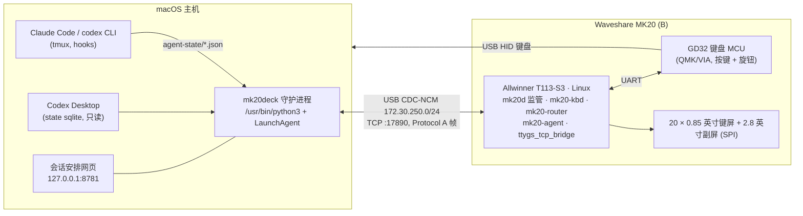

# MK20 Agent Deck

把一块 **Waveshare MK20 (B)** 桌面小键盘（20 个键各带 0.85" LCD + 一块 2.8" 副屏 + 两个旋钮）改造成
**AI 编程助手控制台**：在键屏上实时显示 Claude Code / Codex 各个会话的状态，一键切换会话、批准权限请求、
按住说话、截图发给会话。

*English:* firmware + macOS daemon that turn a Waveshare MK20 (B) macro pad (20 per-key LCDs, a sub-screen,
two knobs) into an agent deck for Claude Code and Codex: live per-session state on the keys, focus a session with
one press, hold-to-approve permission prompts, push-to-talk, one-key screenshot. Docs are mostly in Chinese,
some engineering notes are in English.

> 状态：固件 **v1.8.0**（生产版，CDC-NCM 链路，24 h soak 通过）；Mac 端 **mk20deck 1.8.1**（长按批准、SNAP、
> K1 回看，已在作者的 iMac 上部署，未打 tag）。私有仓库，多人协作见 [CONTRIBUTING.md](CONTRIBUTING.md)。

## 功能

| 功能 | 说明 |
|---|---|
| 会话状态上屏 | L1 页 15 个会话槽：运行中 / 待输入 / 待审批 / 完成未读 / 出错，来源是 Codex Desktop（只读 sqlite）、tmux 里的 Claude Code / codex（hooks 状态记录）、herdr |
| 一键置前 | 单击会话键：Codex 线程 `codex://`、tmux 窗格 + 终端 App |
| 长按批准（1.8.1） | 权限提示出现时，键 1「是」/ 键 2「是，且不再问」要**按住 1 秒并松开**（键上画进度环，成功闪绿 + 提示音）；键 3「否」立即生效；超时、断线、按别的键都会取消，**绝不默认放行** |
| SNAP（1.8.1） | L4 页长按 MODE：全屏截图进剪贴板（需要「屏幕录制」权限） |
| K1 回看 | 左旋钮旋转 = 滚动选中会话的历史，按下 = 回到最新 |
| 选项模式 | 待输入的会话里，数字键由键盘直接发 HID 按键 |
| 会话安排网页 | `127.0.0.1:8781`，一次性链接授权，固定规则 / 钉扎 |
| 设备端 | 自研 `mk20-kbd` 取代原厂 KeyboardDevice 渲染 21 块屏；A/B 槽固件 + 看门狗自动回滚；设备上的网页设置页 |

键盘的实际键面、页面切换、选项选择、长按批准、移动钉扎和 K1 回看流程见[键盘交互图解](docs/keyboard-interaction.md)。图像由仓库里的模拟器按当前控制器逻辑生成，便于在没有设备时理解每个按键的作用。

## 架构



- **链路**：USB 复合设备 = CDC-NCM 网卡（1.8.0 起，之前是 ECM）+ HID + ADB。设备 `172.30.250.2`，Mac
  `172.30.250.1`，另有链路本地 `169.254.7.2` 备用。守护进程把 socket 绑到该网卡（`IP_BOUND_IF`），不受 VPN / TUN 代理影响。
- **协议**：Protocol A（`A1A55A5E` 帧头 + crc32），`ui.*` 事件、`SHOW_JPG` 停等传图。见 `deck/kbd/CTL-PROTOCOL.md`、`deck/NOTES-protocol-re-2026-10-17.md`。

## 目录

| 路径 | 内容 |
|---|---|
| `deck/mk20deck/` | Mac 守护进程（Python ≥ 3.9）：传输、控制器、渲染、适配器（Codex Desktop / tmux / herdr）、网页 |
| `deck/kbd/` | 设备端 `mk20-kbd`（C）：21 块屏 UI、GD32 通信、HID、板载设置页；`UI.md`、`CTL-PROTOCOL.md` |
| `deck/agent/` | 设备端 `mk20-agent`（C，mbedTLS）：网页设置、MCP、LLM 调用、VNC 客户端（computer-use 预研） |
| `deck/router/` | 设备端 `mk20-router` |
| `deck/firmware/` | 固件发布树（`release/`、`rescue/`）、`INSTALL.md`、`RECOVERY.md`、`RELEASE.md`（每版 sha256 与验收证据） |
| `deck/kernel/` | T113 内核补丁（EP3 中断端点、f_ncm）与构建脚本 |
| `deck/tools/` | 安装 / 发布 / 验收 / soak / 延迟测量 / hooks 安装 / Docker 构建镜像 |
| `deck/tests/`, `deck/tests_sim/` | pytest（Linux Docker 全量 + macOS 原生） |
| `deck/mk20sim/`, `sim/` | 基于产品照片的交互模拟器（照片需 `sh sim/assets/photos/fetch.sh` 下载） |
| `deck/reviews/` | 每个里程碑的代码审查、安装 / soak 证据 |
| `tools/cam/` | 可选：俯拍摄像头（ONVIF）快照，用于远程看键屏 |
| `tools/imac/` | Mac 主机工具：`mkadb.sh`（只连 MK20 的 adb 包装）、Docker 镜像构建、代理出口检查 |
| `PRD-mk20-agent-deck.md` | 产品需求（v1.5 已批准）；`GRILL-DECISIONS.md` 决策记录；`PLAN-*.md` 计划 |
| `PROGRESS.md`, `HANDOFF.md` | 进度表 / 交接说明（时间为 UTC+8） |
| `docs/internal/` | 分支级断点续做记录（历史资料） |

## 快速开始（Mac 端）

macOS 15 的「本地网络」隐私会静默拦截未签名的 Python（例如 uv 下载的 3.13），表现为连不上
`172.30.250.2`、也不弹授权。**请用系统自带的 `/usr/bin/python3`（3.9）**。详见 `deck/docs/deploy-system-python.md`。

```sh
cd deck
/usr/bin/python3 -m venv .venv-sys
.venv-sys/bin/pip install "Pillow>=10.1" "pyserial>=3.5" "tomli>=1.1"
mkdir -p ~/.config/mk20-agent-deck && cp config.example.toml ~/.config/mk20-agent-deck/config.toml
PYTHONPATH=$PWD .venv-sys/bin/python -m mk20deck run           # 前台运行
PYTHONPATH=$PWD .venv-sys/bin/python -m mk20deck launchd-plist  # 生成 LaunchAgent（模板见 packaging/）
```

一次性网络设置：`python3 tools/mk20_host_net.py sync`（只改 MK20 那块网卡）。
Agent hooks：`tools/hooks/claude-hooks-install.sh`、`tools/hooks/hooks-install.sh`（codex，装完需在 codex 里信任 hooks）。

## 测试

```sh
make -C deck mac-test          # macOS 原生（设备端 C / BusyBox 测试会跳过）
sh tools/imac/build-image.sh . # 构建 Linux 测试镜像 mk20-build:trixie（deck/tools/build-image/Dockerfile）
# Linux 全量：C（ASan/UBSan）+ pytest + BusyBox 1.27.2 脚本测试（busybox 用 deck/tools/build-image/build-busybox127.sh 构建）
docker run --rm -v "$PWD":/work/wt -v <busybox 目录>:/bb127:ro -w /work/wt/deck \
  -e MK20_TEST_BUSYBOX=/bb127/busybox mk20-build:trixie make test
```

## 固件：安装与回滚（A/B 槽）

```sh
cd deck
make release                                                   # 生成 out/mk20-fw-<v>.tar + .sha256（需 armhf 工具链构建 bins）
sh tools/mk20-install.sh out/mk20-fw-<v>.tar --reboot --wait   # 推到设备，loader 装入空闲槽并标记 pending
```

- 新版本先以 **pending** 启动，自检通过（键屏、GD32、USB、桥接、主机流量等）才 `confirm` 为 good；
  自检失败 / 复合设备建立失败 / 600 s 内未确认，**自动回滚**到上一个 good 槽。
- 手动回滚：`$MK20_ADB shell 'touch /mnt/SDCARD/cmd-rollback && sync'`。
- 固件 tar 不进 git；发布时作为 GitHub Release 附件上传，sha256 记录在 `deck/firmware/RELEASE.md`
  （v1.8.0：`294e15445d225e3eddc28758b60025a32b986f427d354c24ce2f3f2957b3ecc5`，3020800 B）。
- 详见 `deck/firmware/INSTALL.md`、`deck/firmware/RECOVERY.md`、`deck/RECOVERY.md`（VIA 键位备份、GD32、TF 卡恢复）。

## ⚠️ 硬件安全规则（必须遵守）

这些规则来自真实事故，违反可能让键盘变砖或需要拆机救援：

1. **绝不向 GD32 发送 `0x19` 或 `02 AA E2 78`，绝不刷写 GD32 固件**。唯一允许的 GD32 写入是旋钮回显
   `05 00 r r 00 00`（r = 100..105）。
2. **绝不在设备上执行 `reboot`**（这块板子软重启会卡死）。重启只用 `touch /mnt/SDCARD/cmd-reboot && sync`
   （watcher 通过看门狗硬复位）或 `hardreset.sh`。
3. adb 只能通过只连 MK20 的包装脚本（`tools/imac/mkadb.sh`）；不要碰同一台电脑上的其他 adb 设备或串口设备。
4. 设备 adb shell 一次的命令保持在 400 字节以内（adbd 超过 512 B 会溢出并重新枚举 USB）。
5. 改 USB 的操作要脱离前台执行；不要在前台 adb shell 里 `killall adbd`。
6. 刷固件前先备份（TF 分区、`/data`，`tar -X tools/backup-exclude.txt` 会排除设备上的密钥目录）。
7. 密钥（VNC 密码、LLM API key、摄像头密码）只放在设备 `/data/mk20/secrets/`（0600）或本机 `~/.config`，**绝不提交**。

## 路线图

- 1.8.1 打 tag（Mac 端长按批准 + SNAP）；Mac 端测试计时类用例的稳定性修复
- 审批排队与超时回退、副屏额度 / 待机页、语音输入先看再发（本地识别）
- 已知问题：Mac 端 en2 MTU 1500 vs 设备 462；设备 FAT 剩余空间约 1.2 MB

## 许可

本仓库自有代码采用 [MIT 许可证](LICENSE)，Copyright (c) 2026 wenjie zhang。

第三方组件保留各自许可，完整清单见 [THIRD_PARTY.md](THIRD_PARTY.md)，主要包括：`deck/agent/vendor/mbedtls`（Apache-2.0）、
`deck/agent/vendor/zlib`（zlib）、cJSON / stb（MIT）、CA 证书包（MPL-2.0）、DejaVu 字体（`deck/kbd/font-LICENSE-DejaVu.txt`）、Noto Sans SC 字体（`deck/kbd/font-LICENSE-NotoSansSC.txt`）。

**GPL-2.0 部分**：`deck/firmware/release/lib/` 下的内核模块 `usb_f_ncm.ko`、`usb_f_ecm.ko` 以及 `deck/kernel/` 下的内核补丁属于 Linux 内核（5.4.61，Tina），
按 GPL-2.0 分发，不适用 MIT。对应源码（含已打补丁的 `f_ncm.c`、`f_ecm.c`、内核配置和构建脚本）在 [`deck/kernel/gpl/`](deck/kernel/gpl/README.md)。

`deck/firmware/release/bin/` 中的预编译程序静态链接了 GNU C Library（LGPL-2.1+），说明见 THIRD_PARTY.md。设备厂商的原始固件、示例代码与产品照片不随仓库分发。
