# 键盘交互图解

这组图由仓库里的 **SIM 交互模拟器**生成，使用和主程序相同的控制器、布局、渲染器和演示会话数据。它们用于说明键盘实际会显示什么，以及按键、旋钮在不同页面中的作用；模拟器不会连接设备，也不会发送真实的 HID 或审批操作。

运行交互模拟器：

```sh
cd deck
uv run python -m mk20deck sim-serve
```

重新生成某一组静态图：

```sh
uv run python -m mk20deck sim-shots --scenario layout --out ../docs/images/keyboard-sim/layout --static
uv run python -m mk20deck sim-shots --scenario option --out ../docs/images/keyboard-sim/option --static
uv run python -m mk20deck sim-shots --scenario approve --out ../docs/images/keyboard-sim/approve --static
uv run python -m mk20deck sim-shots --scenario move --out ../docs/images/keyboard-sim/move --static
uv run python -m mk20deck sim-shots --scenario scroll --out ../docs/images/keyboard-sim/scroll --static
```

## 先看懂键盘

屏幕上的坐标从左到右是列 1–5，从上到下是行 1–4。L1 的前三行是 15 个会话槽；底排是设备直接发送给 Mac 的按键。L4 把第一行换成模式和页面键，第二、三行继续复用 L1 的 S6–S15，底排不变。

| 位置 | L1 | L4 | 交互 |
| --- | --- | --- | --- |
| 第 1–3 行 | S1–S15 | DESK / HERD / TMUX / 新会话 / 回 L1；S6–S15 | 单击会话键 = 选中并置前；长按会话键 = 拿起移动 |
| 第 4 行第 1 列 | PTT | PTT | 按住说话，设备发送 Right Option |
| 第 4 行第 2 列 | 删除 | 删除 | 设备发送 Backspace |
| 第 4 行第 3 列 | 发送 / 可以 | 发送 / 可以 | 设备发送 Return |
| 第 4 行第 4 列 | 不行 Esc | 不行 Esc | 设备发送 Escape，中断当前 agent 操作 |
| 第 4 行第 5 列 | MODE | MODE | 短按切换模式；长按进 L4；L4 中长按截图 |
| 左旋钮 K1 | — | — | 旋转回看选中会话，按下回到最新；长按进 L4 |
| 右旋钮 K2 | — | — | 短按切换 L1/L4，旋转滚动副屏，长按回 L1 |

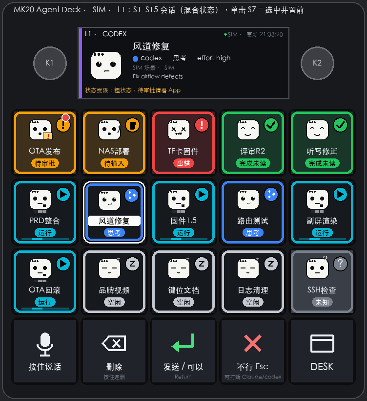

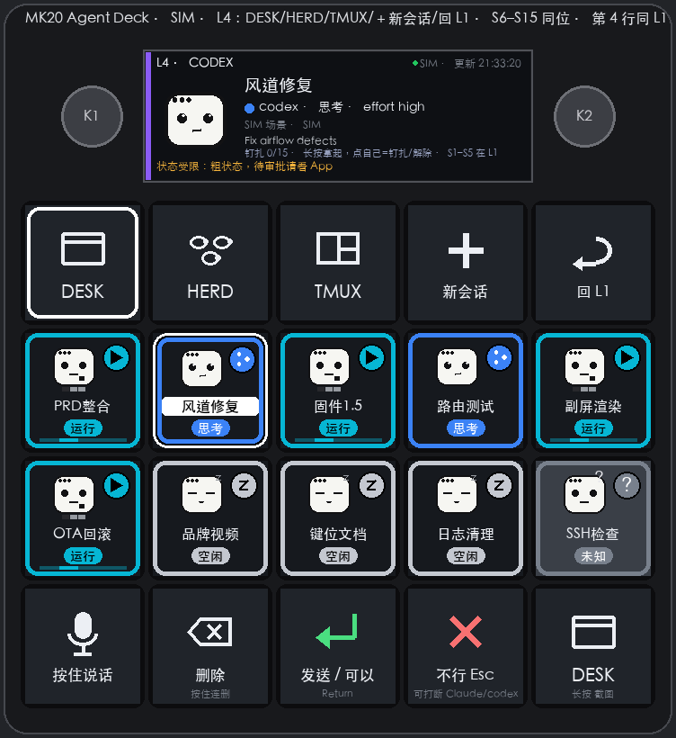

## 页面和状态

L1 的颜色、图标和副屏文字共同表示会话状态；选中的会话会有反色标题牌。L4 的第一行只负责切换模式和页面，其他槽位仍保持和 L1 一样的会话顺序。

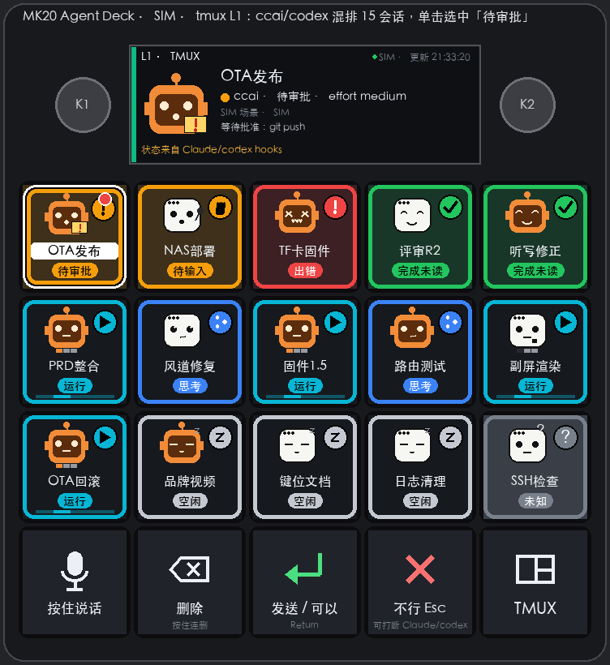

待输入 / 待审批会话被单击后，前三行变成选项键，空白键不会执行会话操作。普通问题由键盘直接把数字发给前台窗口；旧固件没有 `ui.hidKeys` 时，副屏会提示在 Mac 上输入数字。

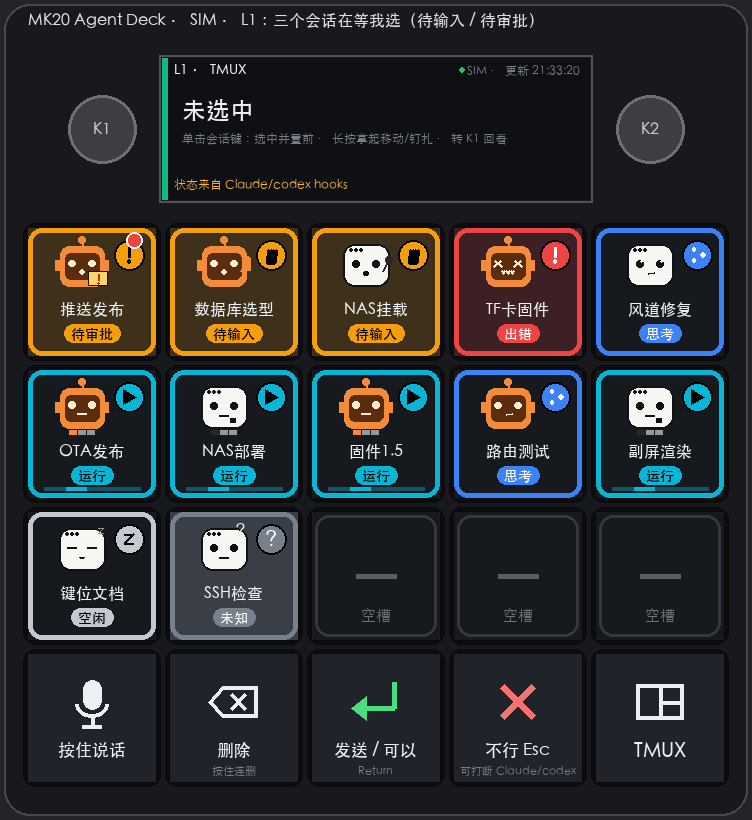

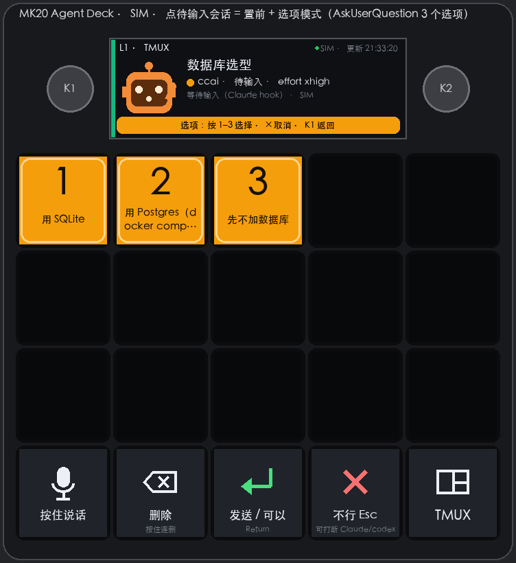

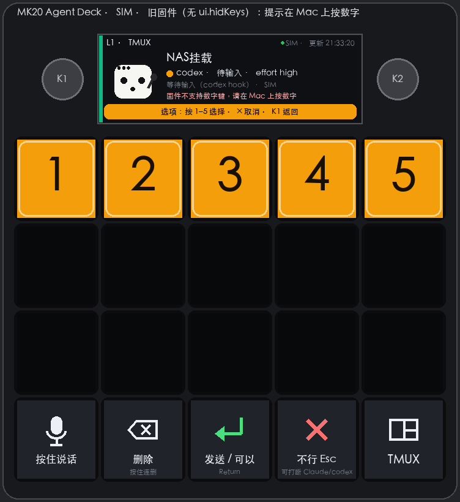

## 长按批准

权限提示中的 S1「是」和 S2「是，且不再问」必须按住默认 1 秒，再松开同一个按键才会批准。进度环未满时不会发送数字；达到时长后仍显示“松开批准”。没有对应抬起、链路没有新 ACK、主循环卡顿、断线、页面变化或期间有其他输入，都会安全取消。S3「否」仍然是设备直接发送的即时拒绝键。

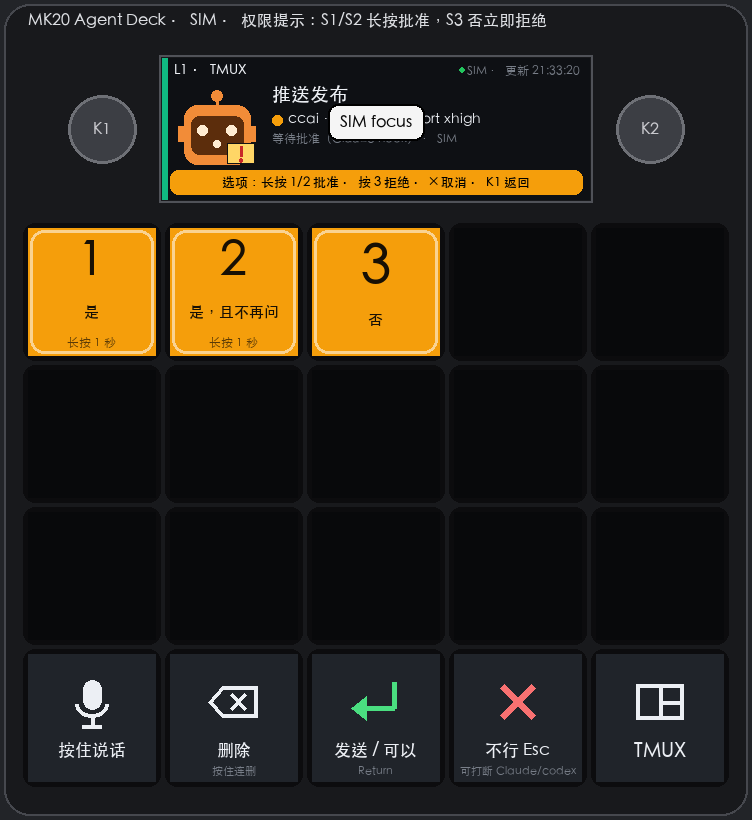

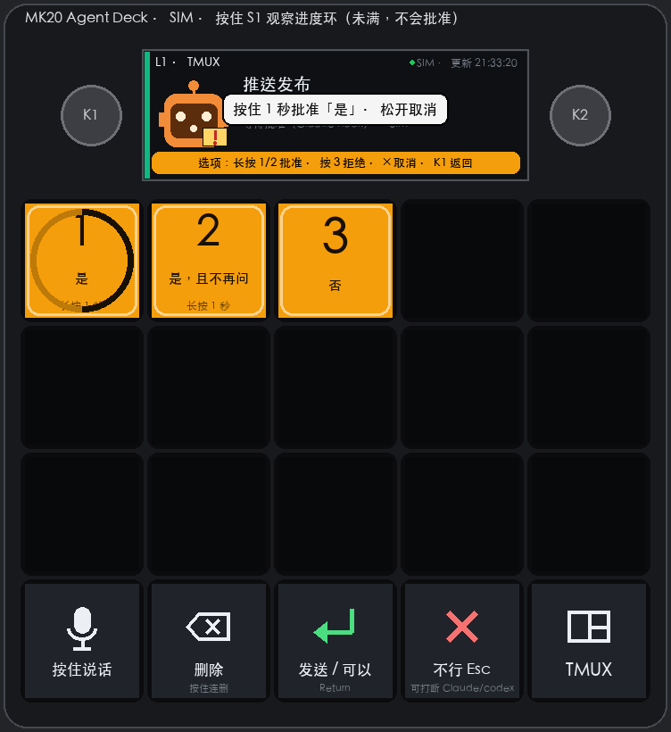

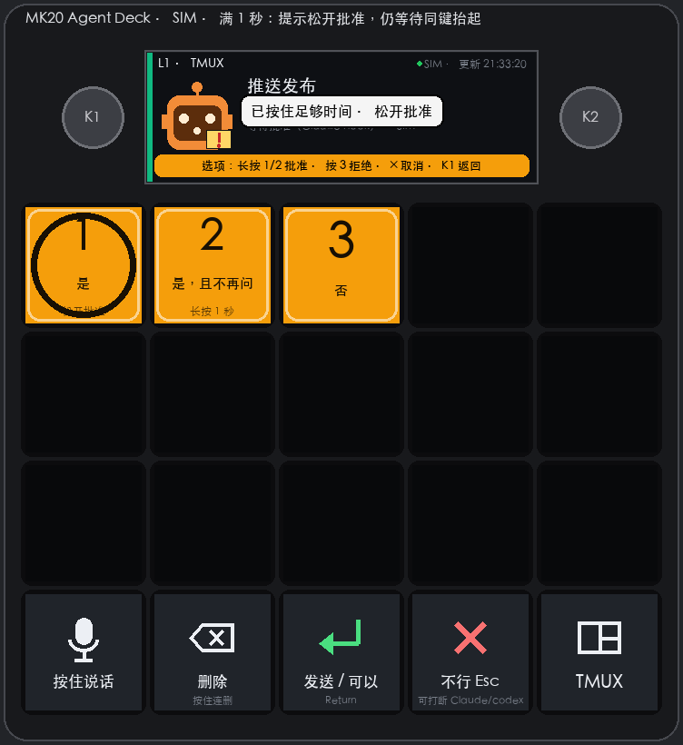

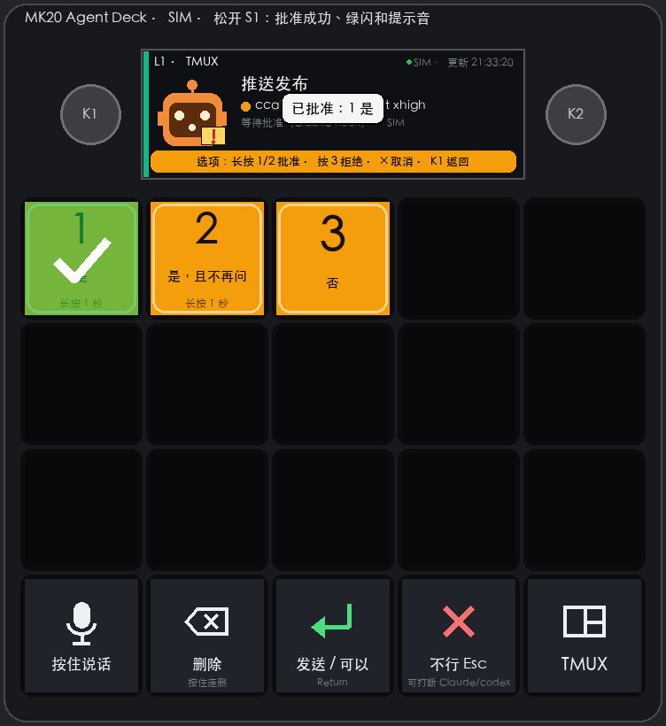

## 移动、钉扎和回看

长按会话键会把它拿起，粉色虚线框表示“移动中”。下一次按键放下并钉住；按同一个键可以切换钉扎，K1 可以取消移动。K1 旋转不会改变选中槽位，而是回看当前会话的历史；按 K1 回到最新内容。

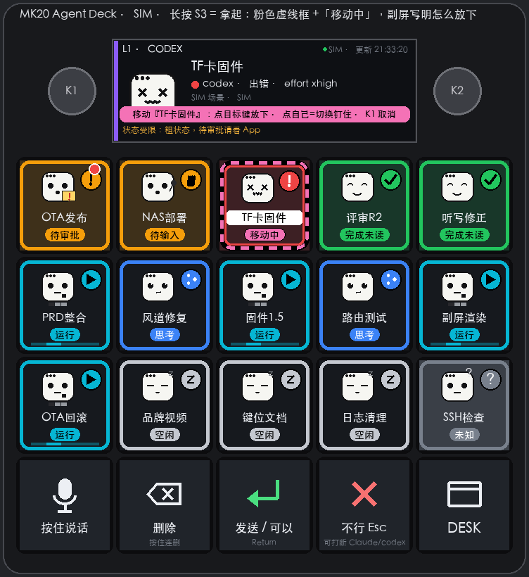

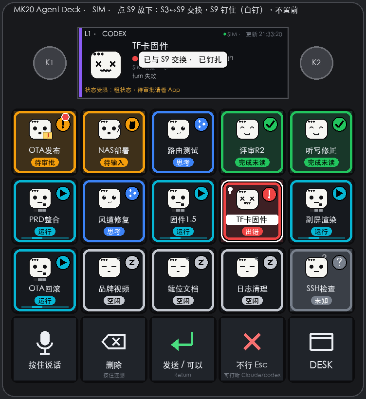

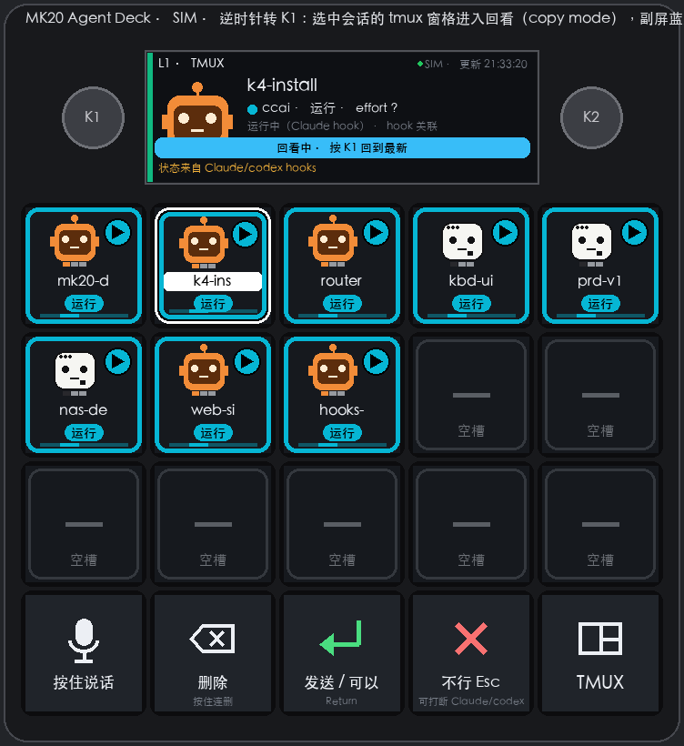

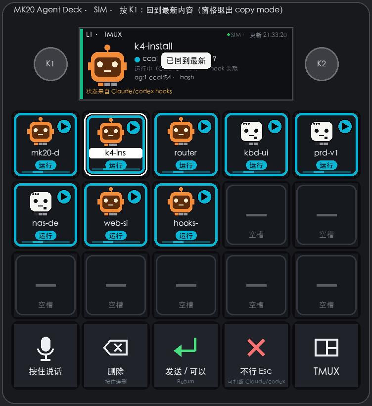

## 截图

在 L4 页面长按 MODE（底排最右）会调用 macOS 截屏并复制到剪贴板；需要给运行 `mk20deck` 的 Python 授予“屏幕录制”权限。L1 页面长按 MODE 仍然只是进入 L4。

完整的按键定义和协议约束见 [`deck/README.md`](../deck/README.md)、[`deck/kbd/UI.md`](../deck/kbd/UI.md) 和 [`docs/PRD-1.5-L1-LAYOUT.md`](../deck/docs/PRD-1.5-L1-LAYOUT.md)。模拟器实现位于 [`deck/mk20deck/sim.py`](../deck/mk20deck/sim.py)，声明式回放用例位于 [`deck/mk20sim/cases/`](../deck/mk20sim/cases/)。
